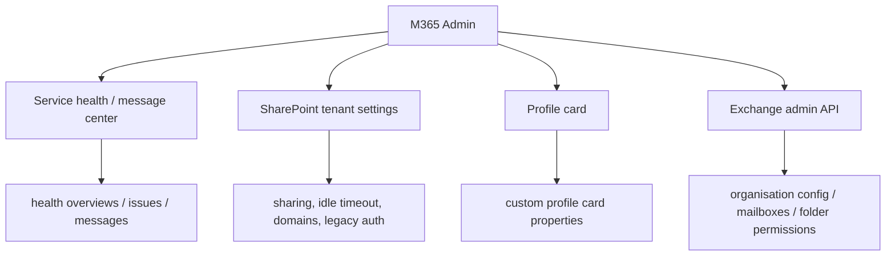

# Microsoft 365 Admin

Examples for common admin-center tasks — service health and message center,
SharePoint tenant settings, profile card customization, and the Exchange
admin API.

---

## Prerequisites

| Permission | Description |
|---|---|
| `ServiceHealth.Read.All` | Read service health and message center |
| `SharePointTenantSettings.ReadWrite.All` | Read / update SharePoint tenant settings |
| `PeopleSettings.Read.All` | Read profile card properties |
| `Exchange.ManageAsAppV2` | Exchange admin calls (mailboxes, folder permissions) |
| `AppRoleAssignment.ReadWrite.All` (delegated) | Grant the permission above, in `exchange_permissions.py` |
| `RoleManagement.ReadWrite.Directory` (delegated) | Assign the directory role that answers for Exchange |

The two Exchange grants are made once per tenant by [`exchange_permissions.py`](./exchange_permissions.py):
it signs in as an administrator, checks both, assigns whichever is missing, then calls the API to
prove they work. After that, [`exchange_admin.py`](./exchange_admin.py) is a plain read.

---

## How it works



---

## Examples

| Scenario | File | Permission |
|---|---|---|
| Message Center + Service Health report | [`service_health_report.py`](./service_health_report.py) | `ServiceHealth.Read.All` |
| SharePoint / OneDrive tenant settings (+ opt-in updates) | [`sharepoint_settings.py`](./sharepoint_settings.py) | `SharePointTenantSettings.ReadWrite.All` |
| Custom profile card properties | [`profile_card.py`](./profile_card.py) | `PeopleSettings.Read.All` |
| **Grant** the Exchange permissions, then check them | [`exchange_permissions.py`](./exchange_permissions.py) | `Exchange.ManageAsAppV2`, `AppRoleAssignment.ReadWrite.All`, `RoleManagement.ReadWrite.Directory` |
| Exchange organisation config + mailboxes | [`exchange_admin.py`](./exchange_admin.py) | `Exchange.ManageAsAppV2` |

---

## Quick start

```python
from office365.graph_client import GraphClient

client = GraphClient(tenant="contoso.onmicrosoft.com").with_client_secret("client_id", "client_secret")

health = client.admin.service_announcement.health_overviews.get().execute_query()
for item in health:
    print(f"  {item.properties.get('service')}  {item.properties.get('status')}")
```

---

## Not yet covered (need library additions)

- **Exchange message trace** (mail-flow diagnostics) — module exists, nav not wired
- **M365 apps update channel** — `AdminMicrosoft365Apps` empty
- **Admin report settings** — empty model

---

## Official docs

- [Admin API overview](https://learn.microsoft.com/en-us/graph/api/resources/admin-api-overview)
- [Service communications API](https://learn.microsoft.com/en-us/graph/api/resources/servicecommunication)
- [SharePoint settings API](https://learn.microsoft.com/en-us/graph/api/resources/sharepointsettings)
